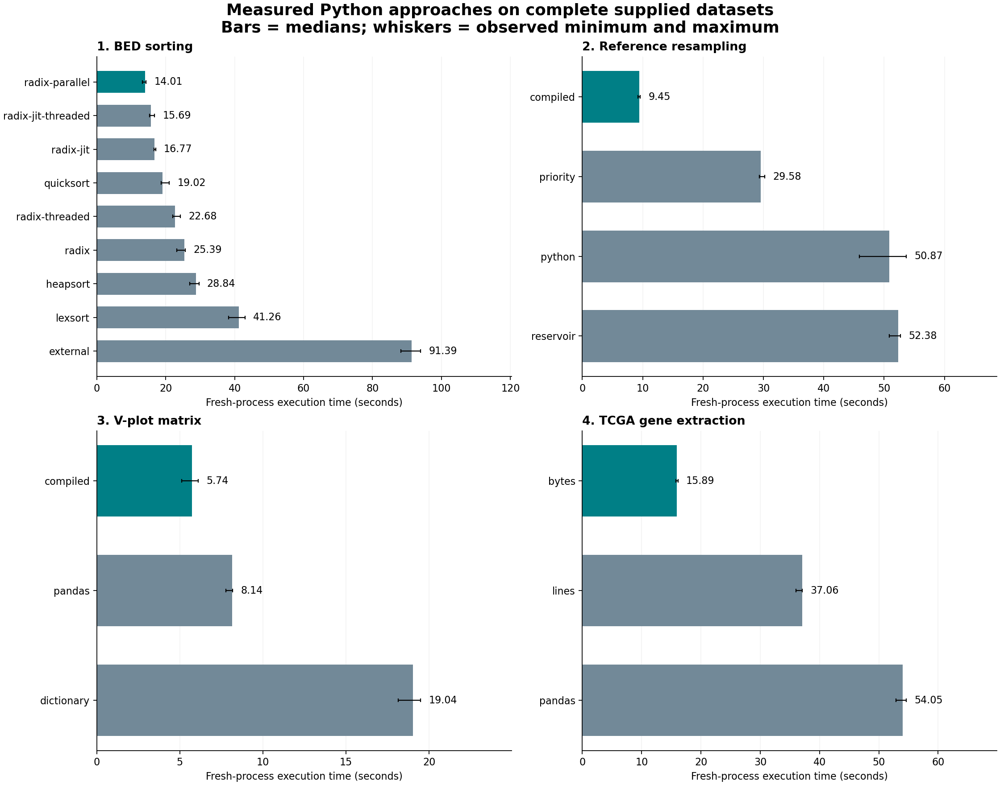

# Semester 1: BEC513 Project

Four Python programs for sorting BED files, matching fragment-length distributions, making a V-plot, and extracting NKX2-1 expression from TCGA-LUAD data.

The main comparison is execution time. Each task has several implementations, with the same input and output requirements. The full results are in [REPORT.md](REPORT.md), and the algorithms are explained in [docs/APPROACHES.md](docs/APPROACHES.md).

## Results at a glance

| Task | Fastest tested method | Mean time |
|---|---|---:|
| BED sorting | Radix sort with parallel reading and output copying | fastest running was 14.01 s |
| Fragment resampling | Sequential sampling with Numba | fastest running was 9.45 s |
| V-plot | Direct matrix counting with Numba | fastest running was 5.74 s |
| NKX2-1 extraction | Exact gene search in each file | fastest running was 15.89 s |

These are full-input timings on an Intel i5-1135G7 laptop with 16 GB RAM.



## Setup

Use **Python 3.10** with the tested package versions. From PowerShell in the project folder:

```powershell
python -m venv .venv
.\.venv\Scripts\Activate.ps1
python -m pip install -r requirements-tested.txt
```

If PowerShell blocks activation, use `.\.venv\Scripts\python.exe` in place of `python` below. On the original computer, the existing Anaconda environment also works:

```powershell
& 'C:\ProgramData\anaconda3\python.exe' run_all.py
```

NumPy, pandas, SciPy and Numba are used. Numba compiles some Python loops on their first call, so the first run takes longer. The dependency versions in `requirements-tested.txt` were tested with Python 3.10.

## Input data

The large inputs are kept locally and excluded from GitHub. Place the supplied `27087241.zip`, `27129882.zip`, and `mapped.bed.gz` in one folder, then run:

```powershell
python prepare_data.py --downloads "D:\Downloads"
```

Change the path if your files are elsewhere. This prepares `data/` from the local archives and records their hashes; it does not download them. Skip this step if `data/` already contains the prepared inputs.

## Run

```powershell
python run_all.py
```

This runs the selected methods from `benchmarks/winners.json` and writes results and plots to `results/`. It replaces previously generated outputs. To run only one task, use `python run_all.py --projects 1`; a list such as `--projects 2 3 4` also works.

Individual commands:

```powershell
# 1. Merge, filter and sort the BED files
python src/sort_bed.py --inputs data/shuf.a.bed.gz data/shuf.b.bed.gz --selection data/selection.tsv --method radix-parallel

# 2. Sample fragments to match the reference distribution
python src/rescale.py --policy strict --output results/rescale/query.strict.bed

# 3. Count fragment lengths and positions
python src/vplot.py --input data/mapped.bed.gz --method compiled

# 4. Extract NKX2-1 expression
python src/tcga.py --archive data/tcga_source.zip --gene NKX2-1 --method bytes
```

Use `--help` on any script to see its options. `run_all.py` creates both resampling outputs: **strict** gives the closer reference match; **capped** keeps more rows. `python src/make_figures.py --project 2` redraws the resampling plot once both outputs exist. Use `--project 3` or `4` for the other plots.

The V-plot script also accepts decompressed BED through standard input (`--input -`). On Linux/macOS:

```sh
gzip -dc data/mapped.bed.gz | python src/vplot.py --input -
```

On Windows, passing the `.gz` file directly avoids text-encoding changes in the PowerShell pipe. For Gnuplot, generate the long-format matrix with `--long --output results/vplot/vplot.long.tsv` and use [docs/vplot.gnuplot](docs/vplot.gnuplot). The included PNG was made with Matplotlib; the Gnuplot recipe has not been tested locally.

## Tests and benchmarks

```powershell
python tests/test_correctness.py
python benchmarks/benchmark.py --project 1 --scope screening --repeats 3
```

For a full-input comparison, use `--scope full`. Select specific methods with `--methods`, for example `--methods radix-parallel quicksort external`. Timsort and chromosome buckets were only tested on smaller inputs because their Python objects need much more memory.

Run benchmarks one at a time. Each run starts a separate process, and observations are appended to `benchmarks/raw_results.jsonl`. Save or rename that file before starting a new set of measurements. `benchmarks/jit_cost.py` measures compilation overhead, while `benchmarks/cold_start_full.py` checks full runs with an empty Numba cache.

## Files

| Location | Contents |
|---|---|
| `src/` | The four programs, shared routines and plotting code |
| `results/` | Tables, summaries and plots; large BED and matrix files stay local |
| `benchmarks/` | Timing scripts, raw measurements and comparison tables |
| `tests/` | Correctness tests and output checks |
| `problem_statement/` | Assignment PDFs and extracted text |
| `docs/APPROACHES.md` | Algorithm details and assumptions |
| `REPORT.md` | Timing tables and interpretation of the results |
| `START_HERE.html` | Results page to open locally in a browser |

`python make_submission_zip.py` creates a ZIP containing the code, notes, plots and compact results. Large datasets and raw BED outputs are left out.

## References

- [Python sorting guide](https://docs.python.org/3.10/howto/sorting.html)
- [NumPy sorting documentation](https://numpy.org/doc/stable/reference/generated/numpy.sort.html)
- [SciPy Wilcoxon test](https://docs.scipy.org/doc/scipy/reference/generated/scipy.stats.wilcoxon.html)
- [SciPy Mann-Whitney test](https://docs.scipy.org/doc/scipy/reference/generated/scipy.stats.mannwhitneyu.html)
